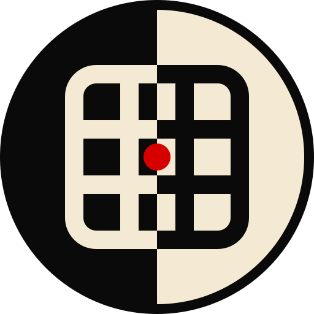

<a id="top"></a>

<div align="center">

<picture>
  <source media="(prefers-color-scheme: dark)" srcset="https://raw.githubusercontent.com/voaneves/sudoku-solver/main/assets/logo/logo-dark.svg" />
  <source media="(prefers-color-scheme: light)" srcset="https://raw.githubusercontent.com/voaneves/sudoku-solver/main/assets/logo/logo-light.svg" />
  
</picture>

<h1>Sudoku Solver</h1>

<p>
  <strong>Notebook that solves 9x9 Sudoku boards, classic or diagonal, using integer programming.</strong><br />
  <sub>Sudoku modeled as a linear program, solved with PuLP</sub>
</p>

<p>
  <a href="https://voaneves.github.io/sudoku-solver/"><picture><source media="(prefers-color-scheme: dark)" srcset="https://raw.githubusercontent.com/voaneves/sudoku-solver/main/assets/buttons/landing-dark.svg" /></picture></a>
  <a href="https://colab.research.google.com/github/voaneves/sudoku-solver/blob/main/sudoku_solver.ipynb"><picture><source media="(prefers-color-scheme: dark)" srcset="https://raw.githubusercontent.com/voaneves/sudoku-solver/main/assets/buttons/colab-dark.svg" /></picture></a>
</p>

<p><sub>Need something like this? <a href="https://voaneves.com/en/#contact"><strong>Let's talk →</strong></a></sub></p>

<p>
  <a href="https://github.com/voaneves/sudoku-solver/blob/main/LICENSE"></a>
  
  <a href="https://github.com/voaneves/sudoku-solver/issues"></a>
</p>

<p>
  <a href="#what-it-does">What it does</a> ·
  <a href="#how-it-works-sudoku-as-a-linear-problem">How it works</a> ·
  <a href="#running-the-notebook">Running</a> ·
  <a href="#em-português">Português</a> ·
  <a href="#contact">Contact</a>
</p>

</div>

<picture>
  <source media="(prefers-color-scheme: dark)" srcset="https://raw.githubusercontent.com/voaneves/sudoku-solver/main/assets/brand/rule-dark.svg" />
  <source media="(prefers-color-scheme: light)" srcset="https://raw.githubusercontent.com/voaneves/sudoku-solver/main/assets/brand/rule-light.svg" />
  
</picture>

## What it does

Solves any 9x9 Sudoku, classic or diagonal, by turning the rules into an integer linear program.

`sudoku_solver.ipynb` solves any 9x9 board given as a list of lists (`0` = empty cell) and prints the solved grid. It handles the standard rules and the "diagonal Sudoku" variant.

## How it works: Sudoku as a linear problem

- **Decision variables:** 9x9x9 binary variables `x[row][col][value]`; `1` means the cell holds that value.
- **Objective:** none (a constant `0`). Only a feasible solution is needed, not an optimal one.
- **Constraints:**
  1. each cell has exactly one value from 1 to 9;
  2. each row contains every value from 1 to 9 once;
  3. each column contains every value from 1 to 9 once;
  4. each 3x3 box contains every value from 1 to 9 once;
  5. (optional, `diagonal=True`) both main diagonals contain every value once;
  6. the pre-filled cells of the input board are fixed as constraints.
- PuLP's default solver (CBC) finds a feasible assignment; if the status is `Optimal`, the solution is extracted and printed.

## Libraries

- [`pulp`](https://pypi.org/project/PuLP/), the only import (`import pulp as plp`). The notebook installs it with `%pip install pulp`.

## Running the notebook

Open it directly in [Google Colab](https://colab.research.google.com/github/voaneves/sudoku-solver/blob/main/sudoku_solver.ipynb), or locally:

```bash
git clone https://github.com/voaneves/sudoku-solver.git
cd sudoku-solver
pip install pulp jupyter
jupyter notebook sudoku_solver.ipynb
```

Run all cells. Section 6 contains two examples (a normal and a diagonal board). To solve your own board:

```python
my_board = [[0]*9 for _ in range(9)]  # fill known values, 0 = empty
solve_sudoku(input_sudoku=my_board, diagonal=False)
```

## Limitations

- 9x9 boards only.
- If the puzzle has no solution, only the solver status is printed.
- The "Random board creator" section of the notebook is still an unfinished placeholder.

## Em português

Resolvedor de Sudoku em Python que trata o jogo como um problema de programação linear inteira, com variáveis binárias (linha, coluna, valor) e restrições de célula, linha, coluna, bloco 3x3, diagonais (opcional) e valores pré-preenchidos, resolvido com a biblioteca PuLP. Para rodar: `pip install pulp jupyter` e abra `sudoku_solver.ipynb`; use `solve_sudoku(tabuleiro, diagonal=False)`, com `0` nas células vazias.

## Contact

<p>
  <a href="https://voaneves.com/en/#contact"><picture><source media="(prefers-color-scheme: dark)" srcset="https://raw.githubusercontent.com/voaneves/sudoku-solver/main/assets/buttons/hire-dark.svg" /></picture></a>
  <a href="https://voaneves.com/en/"><picture><source media="(prefers-color-scheme: dark)" srcset="https://raw.githubusercontent.com/voaneves/sudoku-solver/main/assets/buttons/site-dark.svg" /></picture></a>
</p>

<a href="https://linkedin.com/in/voaneves">LinkedIn</a> · <a href="mailto:victorneves478@gmail.com">E-mail</a>

<p align="center">
  
</p>

<p align="center"><sub>Released under the <a href="https://github.com/voaneves/sudoku-solver/blob/main/LICENSE">MIT License</a>.</sub></p>

<p align="center"><sub><a href="#top">↑ Back to top</a></sub></p>
